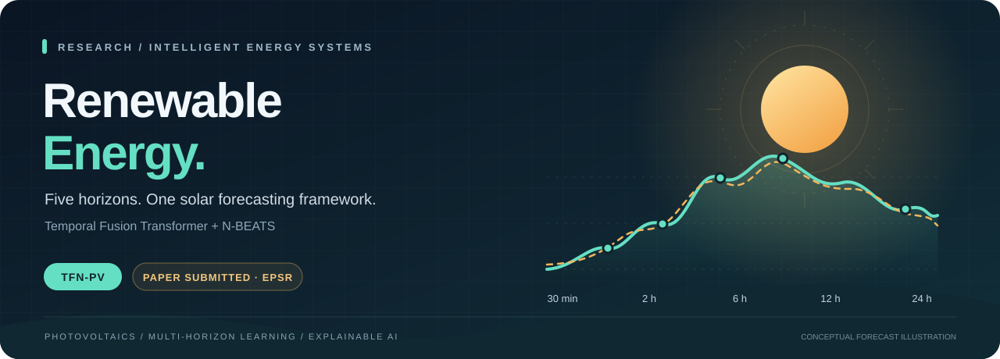
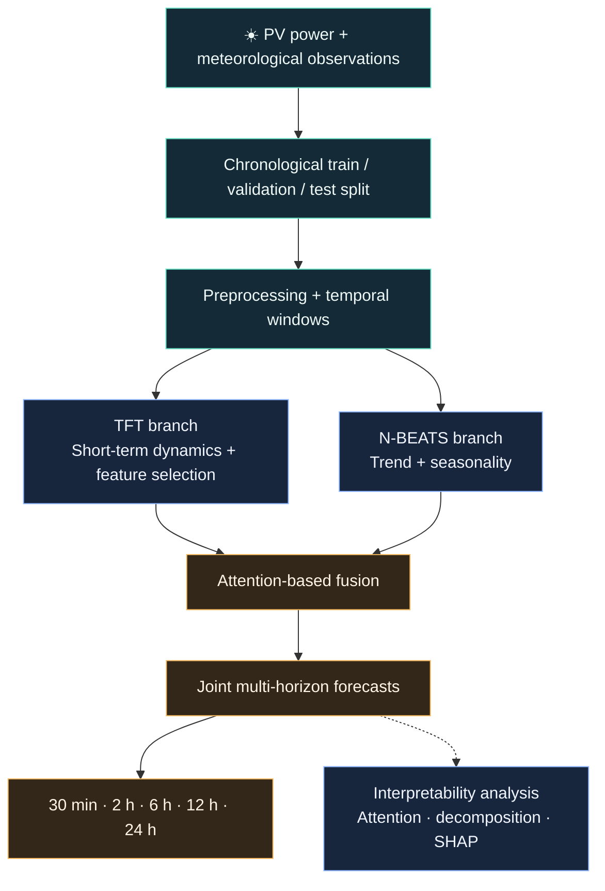

 

### One framework. Five horizons. A clearer view of solar power.

A research home for **TFN-PV**, a hybrid deep learning framework for interpretable, multi-horizon photovoltaic power forecasting.

**[Read the paper](https://arxiv.org/abs/2610.27155)** · **[Explore the research](#research-at-a-glance)** · **[View the architecture](#architecture)** · **[See the results](#reported-results)** · **[Open the demo Space](https://huggingface.co/spaces/rocky250/Re-Energy)**

> [!NOTE]
> The accompanying paper has been **submitted to Elsevier's Electric Power Systems Research (EPSR)**. This repository currently presents the research overview; implementation, experiments, and reproducibility materials are planned for a future release.

## Research at a glance

Solar generation changes with the weather, the time of day, and the season. Useful forecasts need to capture these different rhythms together. TFN-PV combines a **Temporal Fusion Transformer** with **N-BEATS**, then uses attention-based fusion to produce forecasts from half an hour to a full day ahead.

| ☀️ Prediction | 🧠 Architecture | 🔎 Interpretation | 🌏 Evaluation |
| :--- | :--- | :--- | :--- |
| PV active power at **5 horizons** | **TFT + N-BEATS** with adaptive attention fusion | Attention, trend–seasonality decomposition, and SHAP analysis | **4 DKASC time periods** from Alice Springs, Australia |

## Choose a forecast horizon

**Click a row to explore its role.** Each step corresponds to the study's five-minute sampling interval.

<b>⚡ 30 minutes ahead</b> · 6 steps · Fast-changing conditions

Near-term forecasts support grid balancing when irradiance and cloud conditions change quickly.

<b>🔋 2 hours ahead</b> · 24 steps · Short-term dispatch

Short-term generation estimates help inform dispatch and coordination between PV generation, batteries, and the grid.

<b>☀️ 6 hours ahead</b> · 72 steps · Intraday planning

An intraday view helps anticipate the evolving solar generation profile over the next part of the day.

<b>🌤️ 12 hours ahead</b> · 144 steps · Advance preparation

Longer lead times support preparation for upcoming generation and storage needs.

<b>🌍 24 hours ahead</b> · 288 steps · Next-day energy planning

A full-day outlook supports energy scheduling and storage planning across the next daily cycle.

## Architecture

<b>Inside the pipeline</b> — preprocessing, fusion, and explainability

The manuscript describes missing-value handling, Kalman filtering, Isolation Forest anomaly detection, statistical outlier removal, wavelet denoising, and robust scaling before temporal modeling.

- **TFT branch:** learns short-term temporal dependencies and dynamic feature importance.
- **N-BEATS branch:** models longer-term trends and seasonal structure through basis decomposition.
- **Attention fusion:** combines the complementary branch representations for joint forecasting.
- **Interpretability:** examines attention, decomposition, and SHAP-based feature attribution.

Exact configurations and executable reproduction steps will accompany the implementation release.

## Reported results

The submitted manuscript reports the following performance for the proposed hybrid model. Each dataset period was trained and evaluated independently.

| DKASC period | RMSE ↓ | MAE ↓ | MAPE (%) ↓ |
| :--- | ---: | ---: | ---: |
| **2016–2017** | 42.35 | 35.41 | **2.88** |
| **2023** | 46.27 | 38.00 | **3.29** |
| **2024** | 52.29 | 40.08 | **4.02** |
| **2025–2026** | 48.11 | 39.61 | **3.91** |

*Lower is better. These values are transcribed from the manuscript, not reproduced by code in this repository. RMSE and MAE are shown on the manuscript's reported scale; unit, normalization, and horizon-aggregation details will accompany the evaluation materials.*

<b>Explore the evaluation context</b>

**Data source:** Desert Knowledge Australia Solar Centre (DKASC), Alice Springs, Australia, sampled at five-minute intervals.

**Target:** PV active power output.

**Inputs described in the study:** historical power measurements and meteorological variables including global and diffuse horizontal irradiance, ambient temperature, relative humidity, and wind speed.

**Comparisons in the manuscript:** ARIMA, SARIMA, Random Forest, XGBoost, LSTM, GRU, Transformer, N-BEATS, and TFT.

**Additional analyses:** branch/fusion ablations, actual-versus-predicted distributions, and SHAP feature attribution.

Dataset access instructions, exact splits, preprocessing configuration, and runnable evaluation scripts are planned release materials.

## Demo

### [Open the TFN-PV Hugging Face Space ↗](https://huggingface.co/spaces/rocky250/Re-Energy)

The manuscript links to a web interface for multi-horizon PV forecasting.

**Availability:** the linked Space displayed a scheduling/runtime error when checked on **20 October 2026**. The link is retained for access when the Space is restored.

## Paper

**A Hybrid TFT-NBEATS Framework for Robust Multi-Horizon Photovoltaic Power Forecasting**

Shafi Bin Sultan*, Sabik Bin Sultan*, Mohammad Tajrian Arafat Alvi, Rayhanul Islam Sony, and Abdulah Al Numan.

*Equal contribution.

| Item | Details |
| :--- | :--- |
| **Journal** | [Electric Power Systems Research](https://www.sciencedirect.com/journal/electric-power-systems-research) |
| **Publisher** | Elsevier |
| **Status** | **Submitted** |
| **Paper access** | [Read the arXiv preprint — arXiv:2610.27155](https://arxiv.org/abs/2610.27155) |

The preprint is available on [arXiv](https://arxiv.org/abs/2610.27155). Journal publication details and the final citation will be added when available.

## Release roadmap

- [x] Research overview and visual project page
- [x] Model architecture and manuscript-reported results
- [ ] Training and inference implementation
- [ ] Environment setup and dependency specifications
- [ ] Dataset access and preprocessing instructions
- [ ] Experiment configurations, baselines, and evaluation scripts
- [ ] Reproducible notebooks and example forecasts
- [ ] Model checkpoints and usage documentation
- [x] Shareable arXiv preprint link
- [ ] Journal publication and final citation details

## Follow the research

⭐ **Star this repository** to bookmark the project. Use GitHub's **Watch** menu if you would like release notifications.

Have a research question or a suggestion? [Open an issue](https://github.com/Geneeex/renewable-energy/issues).

---

<b>From solar variability to informed energy decisions.</b> 
TFN-PV · Renewable Energy · Multi-horizon forecasting

